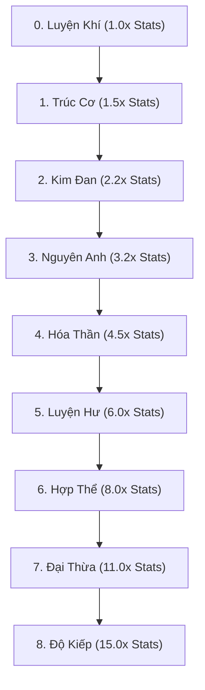

# TÀI LIỆU THIẾT KẾ GAME & BÀN GIAO Ý TƯỞNG (GAME DESIGN DOCUMENT)
**Dự án:** VẠN ĐẠO TRƯỜNG SINH (Van Dao Truong Sinh)  
**Thể loại:** 2D Top-Down ARPG Tiên Hiệp Tu Chân  
**Mục đích:** Lưu trữ toàn bộ linh hồn, cốt truyện, hệ thống chỉ số, công thức chiến đấu và dữ liệu game để tái sử dụng trên các Game Engine chuyên dụng (Godot, Unity, RPG Maker, v.v.).

---

## 1. TỔNG QUAN DỰ ÁN (EXECUTIVE SUMMARY)

### 1.1. Ý Tưởng Cốt Lõi (Core Hook)
- **Nghịch Lý Tu Tiên:** Đa số game tiên hiệp đều cổ vũ việc tăng tiến cảnh giới không ngừng. Nhưng trong *Vạn Đạo Trường Sinh*, bí mật đen tối của thiên địa dần hé lộ: **Mỗi lần đột phá cảnh giới, một phần ký ức và nhân tính của người tu đạo sẽ bị "Thiên Khế" tước đoạt** để đổi lấy linh lực vô biên.
- Người chơi phải liên tục đứng trước lựa chọn: Tiếp tục đột phá để có sức mạnh vô địch nhưng trở thành kẻ máu lạnh vô tình, hay giữ lại hồi ức phàm trần cùng những người mình thương yêu?

### 1.2. Thể Loại & Nhịp Độ Chơi
- **Góc nhìn:** Top-Down 2D (nhìn từ trên xuống góc 3/4).
- **Lối chơi:** ARPG thời gian thực (Real-time Action RPG):
  - Tự do di chuyển 8 hướng bằng WASD / Phím điều hướng.
  - Tấn công thường bằng Chuột Trái (Left Click).
  - Lướt né thần tốc (Spacebar) có khung bất tử (i-frame) để tránh đòn hiểm của quái và boss.
  - Thanh 4 kỹ năng chủ động (Phím 1, 2, 3, 4) phối hợp giữa đạn tầm xa, quét dọn diện rộng, khiên phòng hộ và tuyệt kỹ giáng đòn.

---

## 2. HỆ THỐNG 3 ĐẠI CON ĐƯỜNG TU LUYỆN (CULTIVATION PATHS)

| Đặc Điểm | Kiếm Tu (Sword) | Pháp Tu (Spell) | Thể Tu (Body) |
|---|---|---|---|
| **Định vị** | Sát thương cao, bạo kích mạnh, cơ động | Tầm xa, sát thương diện rộng (AoE), khống chế | Chống chịu cực cao, phản đòn, hồi phục |
| **Vũ khí đặc trưng** | Phi Kiếm, Bích Ngọc Kiếm, Trọng Kiếm | Pháp Trượng, Linh Phù, Pháp Châu | Quyền Sáo (Găng tay), Thiết Bổng |
| **Chỉ số gốc (Base Stats)** | • HP: 100 • MP: 50 • ATK: 25 • DEF: 10 • SPD: 110 • Crit: 15% | • HP: 80 • MP: 100 • ATK: 30 • DEF: 8 • SPD: 95 • Crit: 5% | • HP: 150 • MP: 30 • ATK: 18 • DEF: 20 • SPD: 90 • Crit: 5% |
| **Kỹ năng mẫu (Cấp 1)** | • *Thanh Phong Kiếm Khí*: Bắn đạn kiếm khí bay xuyên thấu. • *Huyền Thiên Nhất Kiếm*: Chém quét vòng cung 160° phía trước. • *Hộ Thể Kiếm Cương*: Khiên kiếm xoay tròn giảm 50% sát thương. • *Vạn Kiếm Quy Tông*: Triệu hồi Cự Kiếm cắm thẳng từ trời. | • *Hỏa Cầu Thuật*: Bắn quả cầu lửa phát nổ. • *Băng Phong Trận*: Đóng băng làm chậm vùng đất. • *Linh Thuẫn*: Khiên hấp thụ sát thương quy đổi thành mana. • *Lôi Đình Vạn Quân*: Bão sấm sét đánh toàn màn hình. | • *Thiết Sơn Kháo*: Lao mình ủi bay kẻ địch. • *Kim Chung Tráo*: Tăng 100% giáp trong 5 giây. • *Bất Hoại Thân*: Hồi phục 20% sinh lực khi trúng đòn hiểm. • *Thiên Băng Địa Liệt*: Dậm chân rung chuyển mặt đất gây choáng. |

---

## 3. HỆ THỐNG 9 ĐẠI CẢNH GIỚI TU TIÊN (CULTIVATION REALMS)

Mỗi cảnh giới chia làm 4 tiểu tầng: **Sơ Kỳ (Tier 0) -> Trung Kỳ (Tier 1) -> Hậu Kỳ (Tier 2) -> Đại Viên Mãn (Tier 3)**.

### Công Thức Nhân Chỉ Số Cảnh Giới:
$$\text{Stats}_{\text{final}} = (\text{Base} + \text{Equip}) \times \text{RealmMultiplier} \times (1 + \text{Tier} \times 0.05)$$

- **Tốc độ di chuyển:** Không tăng quá nhanh để tránh vỡ game:
  $$\text{SPD} = \text{BaseSPD} \times (1 + \text{RealmIndex} \times 0.05)$$
- **Đột phá cảnh giới lớn:** Cần tích lũy đủ điểm Tu Vi (Cultivation EXP) qua bế quan/nhiệm vụ kết hợp với **Đan Dược Phá Chướng** tương ứng (ví dụ: Trúc Cơ Đan, Kim Đan Sa, Hóa Thần Thảo).

---

## 4. CÔNG THỨC CHIẾN ĐẤU & CƠ CHẾ ARPG (COMBAT MECHANICS)

### 4.1. Công Thức Tính Sát Thương Thực Tế
$$\text{Damage} = \text{ATK} \times \text{SkillMultiplier} \times \left( \frac{100}{100 + \text{DEF}_{\text{target}}} \right) \times \text{CritFactor} \times \text{RandomVariance}(0.95 \dots 1.05)$$
- Nếu đòn đánh kích hoạt Bạo Kích (Crit): $\text{CritFactor} = \text{CritDamage} = 1.5$ (mặc định) đến $2.5$.
- Nếu không bạo kích: $\text{CritFactor} = 1.0$.

### 4.2. Cơ Chế Lướt Né (Dodge & i-Frame)
- **Thời lượng lướt (Dodge Duration):** 220 ms.
- **Tốc độ lướt:** Tăng gấp $2.2$ lần tốc độ chạy thường.
- **Khung bất tử (i-Frame Window):** 180 ms (bắt đầu từ ms thứ 20 đến ms thứ 200). Trong khoảng thời gian này, bất kỳ sát thương hay đạn bay nào chạm vào người chơi đều được bỏ qua (hoàn toàn miễn nhiễm).
- **Hồi chiêu (Cooldown):** 1.20 giây (ngăn chặn tình trạng spam bất tử).

### 4.3. Cơ Chế Boss Chiến (Boss Fight AI)
- **Vùng cảnh báo đỏ (Telegraph Red Zone):** Trước khi tung chiêu sát chiêu lớn, Boss hiển thị một vòng tròn hoặc dải hình chữ nhật màu đỏ nhấp nháy trong $0.8 \dots 1.2$ giây để người chơi dùng kỹ năng lướt né ra ngoài.
- **Giai đoạn Cuồng Bạo (Enrage / Phase 2):** Khi sinh lực của Boss giảm xuống dưới 40%:
  - Tốc độ di chuyển tăng 30%.
  - Sức tấn công tăng 35%.
  - Tần suất dùng chiêu nộ gấp đôi.

---

## 5. TÓM TẮT CỐT TRUYỆN 8 CHƯƠNG & 3 ĐẠI KẾT CỤC

1. **Chương 1 - Làng Thanh Khê (Dị Biến & Thức Tỉnh):** Linh khí thôn quê hỗn loạn, thú hoang biến dị. Nhân vật chính tiêu diệt Lang Vương, nhặt được mảnh Thiên Thư đầu tiên có khả năng bảo lưu ký ức.
2. **Chương 2 - Thanh Vân Môn (Ký Ức Đánh Mất):** Gia nhập kiếm tông, phát hiện các bậc trưởng lão sau khi đột phá cảnh giới cao đều quên sạch người thân và quá khứ kiếp phàm.
3. **Chương 3 - Đan Hà Cốc (Đan Dược Cấm Kỵ):** Vạch trần việc các đại tông môn ngầm dùng đan dược tẩy xóa tâm trí để tạo ra những cỗ máy tu tiên trung thành.
4. **Chương 4 - U Hồn Cực Địa (Tiếng Vọng Oan Linh):** Bước vào cấm địa cổ xưa, gặp gỡ tàn hồn của các bậc đại năng đời trước – những người từng phát hiện chân tướng Thiên Đạo nhưng bị thanh trừng.
5. **Chương 5 - Huyền Thiên Kiếm Trũng (Tâm Kiếm Nhập Đạo):** Rèn đúc bản mệnh tiên kiếm, giác ngộ đạo tâm: "Tu tiên vì ai? Tu tiên để làm gì?".
6. **Chương 6 - Bắc Băng Cung (Hàn Băng Phong Ký):** Tìm kiếm phương pháp phong ấn ký ức vào hàn ngọc để chuẩn bị đối mặt với Thiên Kiếp Nguyên Anh.
7. **Chương 7 - Viễn Cổ Di Tích (Thiên Khế Chân Tướng):** Khám phá bí mật lớn nhất thế giới: Toàn bộ thế giới tu tiên thực chất là một "nông trại nuôi dưỡng linh hồn" do Thượng Giới thiết lập.
8. **Chương 8 - Vạn Đạo Chi Đỉnh (Quyết Định Cuối Cùng):** Đứng trước cánh cổng phi thăng Thượng Giới, mở ra 3 Đại Kết Cục:
   - **Kết Cục 1 (Vô Tình Phi Thăng):** Chấp nhận xóa sạch ký ức kiếp phàm, trở thành Tiên Nhân thượng giới cô độc vĩnh hằng.
   - **Kết Cục 2 (Nghịch Thiên Phá Đạo):** Dùng mảnh Thiên Thư phá hủy Thiên Khế, chặt đứt đường phi thăng, bảo vệ nhân thế và giữ lại trọn vẹn nhân tính.
   - **Kết Cục 3 (Luân Hồi Trọng Sinh):** Tự phế toàn bộ tu vi cảnh giới, dùng linh lực của bản thân chữa lành vết nứt thế giới và quay về làm một người phàm bình yên bên người mình thương.

---

## 6. GÓI DỮ LIỆU ĐÃ XUẤT SẴN RA THƯ MỤC `game-data-export/`

Toàn bộ thông số game đã được xuất sạch ra định dạng JSON chuẩn để bạn chỉ việc copy vào bất kỳ dự án mới nào:

| Tệp Dữ Liệu | Đường Dẫn | Nội Dung Chi Tiết |
|---|---|---|
| **Vật phẩm & Trang bị** | `game-data-export/items.json` | 15 trang bị, vũ khí, áo giáp, đan dược, nguyên liệu rèn với đầy đủ phẩm cấp và chỉ số. |
| **Kỹ năng chiến đấu** | `game-data-export/skills.json` | Danh sách 36 kỹ năng (Kiếm Tu, Pháp Tu, Thể Tu) kèm mana cost, cooldown, damage ratio. |
| **Quái vật thường** | `game-data-export/monsters.json` | Chỉ số Sói Xám, Sói Đen, Rắn Độc, Yêu Hồ, Sói Tinh (HP, ATK, DEF, EXP rơi). |
| **Bosses** | `game-data-export/bosses.json` | Chỉ số, kỹ năng và cơ chế chuyển pha của Xích Nha Lang Vương và Cổ Thụ Yêu. |
| **Nhiệm vụ** | `game-data-export/quests.json` | Toàn bộ chuỗi nhiệm vụ chính tuyến và phụ tuyến Chương 1 kèm điều kiện hoàn thành và phần thưởng. |
| **Bản đồ thế giới** | `game-data-export/maps.json` | Cấu trúc map Làng Thanh Khê, Rừng Săn Bắn, vị trí NPC, quái vật và cổng dịch chuyển. |
| **Cốt truyện 8 chương** | `game-data-export/story_chapters.json` | Chi tiết bối cảnh, sự kiện mở đầu, cao trào và NPC trọng tâm của 8 chương. |
| **Cảnh giới & Chỉ số** | `game-data-export/realms_and_stats.json` | Bảng tên 9 cảnh giới, hệ số nhân sức mạnh, chỉ số gốc 3 phái và cấu hình lướt né. |
| **Điều kiện đột phá** | `game-data-export/breakthrough_requirements.json` | EXP tu vi cần thiết và đan dược phụ trợ để vượt tầng. |
| **Schema Cơ Sở Dữ Liệu** | `game-data-export/schema.sql` | Mã DDL SQL chuẩn (tương thích SQLite, MySQL, PostgreSQL) cho Accounts, Characters, Inventory, Skills, Quests. |

---

## 7. HƯỚNG DẪN CHUYỂN ĐỔI SANG GAME ENGINE MỚI

Nếu bạn muốn bắt đầu làm lại dự án với chất lượng đồ họa tốt nhất, dưới đây là các khuyến nghị cụ thể:

### 7.1. Nên Chọn Engine Nào?

1. **Godot Engine 4.x (Khuyên dùng số 1 cho Game 2D Indie):**
   - **Ưu điểm:** Miễn phí 100%, cực kỳ nhẹ (chỉ ~50MB tải về chạy ngay), hệ thống 2D là Native (không phải 2.5D như Unity).
   - **Xử lý ARPG:** Dùng `CharacterBody2D` cho nhân vật và quái, `move_and_slide()` xử lý va chạm cực kỳ mượt mà.
   - **Import dữ liệu:** Đọc các file JSON trong `game-data-export/` bằng `JSON.parse_string()` chỉ trong 2 dòng code.
2. **Unity 2022/2026 LTS:**
   - **Ưu điểm:** Hệ sinh thái đồ họa Asset Store khổng lồ, hỗ trợ Animation 2D Spine cực mạnh.
   - **Cách tổ chức:** Chuyển các file JSON thành `ScriptableObject` để quản lý Item và Skill trực quan trong Inspector.
3. **RPG Maker (MZ / MV):**
   - **Ưu điểm:** Dễ làm nhất nếu bạn muốn tập trung vào cốt truyện, hội thoại và nhiệm vụ mà không cần viết nhiều code.
   - **Để chơi ARPG:** Cài đặt các plugin Action Battle System (ABS) nổi tiếng như *Chrono Engine* hoặc *Alpha ABS*.

### 7.2. Lời Khuyên Tìm Kiếm Đồ Họa 2D Tiên Hiệp Đẹp
- **Bộ vẽ sẵn chất lượng cao:** Tìm kiếm trên **[itch.io](https://itch.io/game-assets/free/tag-top-down/tag-pixel-art)** hoặc **Unity Asset Store** với từ khóa: `Wuxia 2D`, `Xianxia Sprite`, `Asian Fantasy Tileset`, `Top-Down Action Character`.
- **Hoạt ảnh động nhân vật:** Nếu muốn nhân vật mượt mà như game thương mại, hãy tìm các bộ asset xuất từ **Spine 2D** (có xương chuyển động) hoặc spritesheet vẽ tay từng khung hình (frame-by-frame) từ các pixel artist trên DeviantArt/Fiverr.

---
*Tài liệu này và toàn bộ thư mục `game-data-export/` là tài sản trí tuệ thuộc quyền sở hữu của bạn. Bạn có thể sử dụng tự do bất kỳ lúc nào.*
