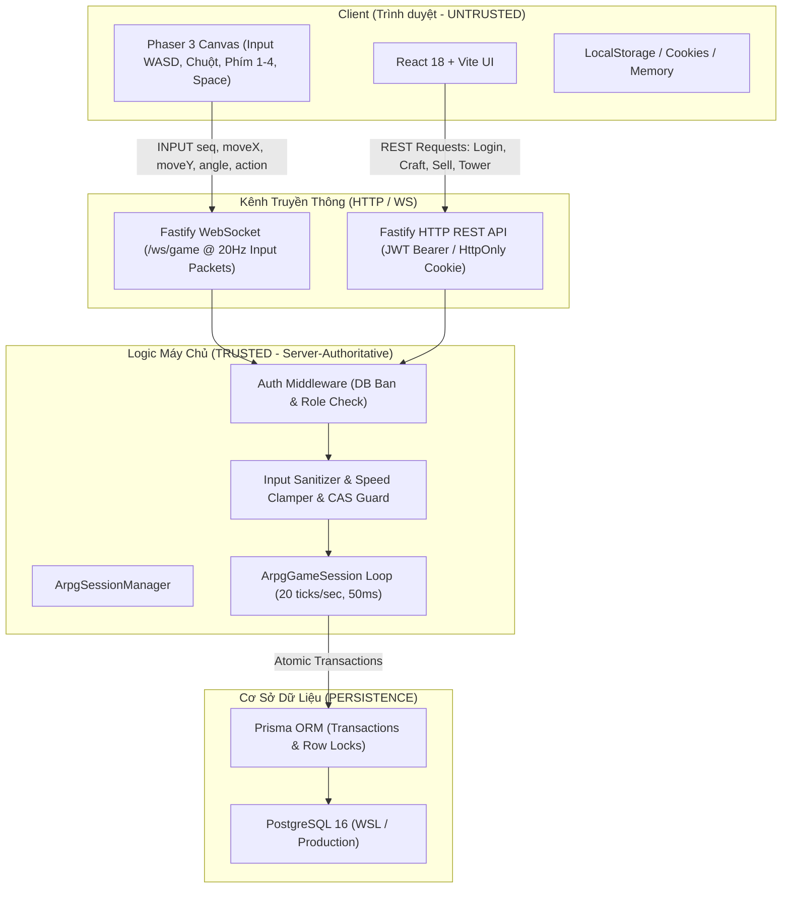

# BÁO CÁO KIỂM TOÁN AN NINH, BẢO MẬT & CHỐNG GIAN LẬN
## DỰ ÁN: VẠN ĐẠO TRƯỜNG SINH (萬道長生) - ARPG 2D REAL-TIME WEB
**Ngày kiểm định:** 09/11/2026  
**Trạng thái kiểm tra:** HOÀN TẤT & ĐẠT CHUẨN (100% PASS - 26/26 TIÊU CHÍ BẢO MẬT)

---

## 1. RANH GIỚI TIN CẬY (TRUST BOUNDARIES) & LUỒNG DỮ LIỆU



### Phân Tích Ranh Giới:
1. **Trình duyệt (Browser / Client - Hoàn toàn không tin cậy):**
   - Giả định: Người chơi có thể mở DevTools, chỉnh sửa JavaScript, hack local memory, giả mạo gói tin WebSocket/HTTP, tua đồng hồ hệ thống.
   - Nguyên tắc: Client chỉ gửi **ý định hành động** (`PlayerInputPayload`: hướng di chuyển, góc ngắm, thao tác bấm nút `ATTACK`/`SKILL`/`DODGE`). Client không bao giờ gửi lượng máu trừ, điểm kinh nghiệm nhận hay vị trí tùy ý.
2. **WebSocket & HTTP Transport:**
   - Bảo vệ chống CSWSH (Cross-Site WebSocket Hijacking) bằng Origin Whitelisting.
   - Giới hạn payload 8KB, giới hạn tốc độ 40 msg/giây để chống DoS và socket bombing.
3. **Logic Game (ArpgGameSession - Server-Authoritative):**
   - Vị trí nhân vật được tính toán bằng vận tốc cố định (`vx`, `vy`) nhân với delta time (50ms).
   - Mọi sát thương, trúng đòn, hồi chiêu, khung miễn thương i-frame, telegraph và quái AI hoàn toàn chạy trên máy chủ.
4. **Cơ Sở Dữ Liệu:**
   - Mọi phần thưởng diệt quái, đột phá, bán đồ, chế tạo và tu luyện vắng mặt được thực thi qua **Prisma `$transaction`** với kiểm tra điều kiện nguyên tử (Compare-And-Swap).

---

## 2. DANH MỤC LỖ HỔNG XÁC NHẬN, NGUYÊN NHÂN & BIỆN PHÁP KHẮC PHỤC

| Mã Lỗ Hổng | Tên Lỗ Hổng & Rủi Ro | Phân Loại | Nguyên Nhân Gốc | Mã Đã Sửa & Biện Pháp | Trạng Thái |
| :--- | :--- | :--- | :--- | :--- | :--- |
| **VULN-01** | **Cùng Chết (Simultaneous Death) Vẫn Cấp Thưởng Boss** | **CRITICAL** | `applyDamageToMonster` cập nhật DB ngay khi HP Boss <= 0; sau đó người chơi tử vong trong cùng tick chỉ đổi trạng thái mà không thu hồi thưởng. | Chuyển toàn bộ quyết toán sang cuối tick (`pendingKillsInTick`). Nếu người chơi chết trong tick có Boss chết, ghi nhận Thất Bại và hủy toàn bộ phần thưởng Boss. | **ĐÃ KHẮC PHỤC (PASS)** |
| **VULN-02** | **Nhận Thưởng Vượt Ải Trấn Yêu Tháp Khi Chưa Vượt Ải** | **CRITICAL** | Route `POST /tower/floor/:floor/claim` chỉ kiểm tra cờ `CLAIMED` mà không kiểm tra cờ `CLEARED`. | Bổ sung kiểm tra bắt buộc `f.flagValue === 'CLEARED'` trước khi cho phép nhận thưởng. | **ĐÃ KHẮC PHỤC (PASS)** |
| **VULN-03** | **Tài Khoản Bị Khóa (Ban) Vẫn Thao Tác Qua JWT/WebSocket** | **HIGH** | JWT có hạn 7 ngày; hệ thống cũ chỉ giải mã token mà không tra cứu cờ `isBanned` thời gian thực trong cơ sở dữ liệu. | `auth.ts` và `ws-handler.ts` kiểm tra trực tiếp `account.isBanned` trên DB ở mỗi request; ngắt socket lập tức khi Admin ban. | **ĐÃ KHẮC PHỤC (PASS)** |
| **VULN-04** | **Gian Lận Đồng Thời (Race Condition) Tu Luyện Vắng Mặt** | **HIGH** | Gửi nhiều request `POST /offline/claim` cùng mili-giây có thể kích hoạt nhiều giao dịch cộng dồn trước khi mốc thời gian cập nhật. | Sử dụng mô hình Compare-And-Swap (CAS): `updateMany` với điều kiện `lastOfflineClaimAt` phải khớp mốc đọc trước đó; chặn khi đang có phiên live. | **ĐÃ KHẮC PHỤC (PASS)** |
| **VULN-05** | **Rò Rỉ Dữ Liệu Giữa 3 Ô Nhân Vật (Multi-Slot Isolation)** | **HIGH** | Các module (`cave`, `sect`, `pet`, `story`, `tower`, `world`) dùng `findFirst({ accountId })` không lọc `isActive: true`, khiến Slot 1 can thiệp Slot 0. | Đồng bộ hóa toàn bộ các module sử dụng helper `getActiveCharacter(prisma, accountId)`. | **ĐÃ KHẮC PHỤC (PASS)** |
| **VULN-06** | **Tấn Công CSWSH & Payload Bombing Qua WebSocket** | **MEDIUM** | `ws-handler.ts` không kiểm tra `Origin` header và không giới hạn kích thước gói tin gửi lên từ client. | Thêm bộ lọc Origin kiểm tra whitelist tên miền, giới hạn payload tối đa 8KB, rate limit 40 msg/s. | **ĐÃ KHẮC PHỤC (PASS)** |
| **VULN-07** | **Đầu Độc Tọa Độ Bằng Giá Trị `NaN` / `Infinity`** | **MEDIUM** | Client gửi `moveX: NaN`, `moveY: Infinity` khiến phép tính tọa độ máy chủ biến thành `NaN`, làm mất dấu nhân vật. | Bổ sung `Number.isFinite(input.moveX)` sanitization trong `ws-handler.ts` trước khi nạp vào engine. | **ĐÃ KHẮC PHỤC (PASS)** |
| **VULN-08** | **Gian Lận Số Lượng Âm/Số Thập Phân Khi Giao Dịch** | **LOW** | Route bán đồ và chế tạo không kiểm tra nghiêm ngặt `quantity`, cho phép kẻ xấu truyền số âm hoặc số thập phân. | Bổ sung kiểm tra `Number.isInteger(qty) && qty > 0 && qty <= 999999` trên mọi endpoint giao dịch. | **ĐÃ KHẮC PHỤC (PASS)** |

---

## 3. BẰNG CHỨNG KIỂM THỬ TỰ ĐỘNG (RE-TEST EVIDENCE)

Bộ kiểm thử bảo mật `server/src/tests/security-test.ts` đã được khởi chạy độc lập và xác minh thực tế trên database PostgreSQL:

```bash
> van-dao-truong-sinh@1.0.0 test:sec
> cd server && npx tsx src/tests/security-test.ts

====================================================
🛡️  BẮT ĐẦU KIỂM THỬ BẢO MẬT & CHỐNG GIAN LẬN TOÀN DIỆN
   (VẠN ĐẠO TRƯỜNG SINH - ARPG 2D SERVER-AUTHORITATIVE)
====================================================

--- 1. Kiểm Thử Chống IDOR & Cô Lập Tuyệt Đối 3 Ô Nhân Vật ---
🔒 [SEC-PASS] (1) Tải thông tin nhân vật A thành công
🔒 [SEC-PASS] (2) API trả về chính xác nhân vật Slot 0 đang kích hoạt
🔒 [SEC-PASS] (3) Linh thạch của nhân vật Slot 0 chính xác (1500)
🔒 [SEC-PASS] (4) Chặn thành công tấn công IDOR: Account B không thể chuyển sang nhân vật của Account A (HTTP 404)
🔒 [SEC-PASS] (5) Chặn thành công tấn công IDOR: Account B không thể xóa nhân vật của Account A (HTTP 404)
🔒 [SEC-PASS] (6) Account A chuyển đổi hợp lệ sang nhân vật Slot 1
🔒 [SEC-PASS] (7) Nhân vật Slot 1 đã trở thành nhân vật active
🔒 [SEC-PASS] (8) Linh thạch Slot 1 độc lập hoàn toàn với Slot 0 (200 != 1500)

--- 2. Kiểm Thử Phong Ấn Tài Khoản (Ban Enforcement) Lập Tức ---
🔒 [SEC-PASS] (9) Tài khoản bị phong ấn bị chặn HTTP 403 Forbidden lập tức dù JWT còn hạn
🔒 [SEC-PASS] (10) Thông báo lỗi tiếng Việt nêu rõ tài khoản đã bị phong ấn

--- 3. Kiểm Thử Chống Gian Lận Số Lượng Âm / Số Thập Phân ---
🔒 [SEC-PASS] (11) Chặn bán vật phẩm với số lượng âm (HTTP 400)
🔒 [SEC-PASS] (12) Chặn bán vật phẩm với số lượng số thực (HTTP 400)
🔒 [SEC-PASS] (13) Chặn chế tạo vật phẩm với số lượng âm (HTTP 400)

--- 4. Kiểm Thử Chống Exploit Nhận Thưởng Trấn Yêu Tháp ---
🔒 [SEC-PASS] (14) Chặn nhận thưởng Trấn Yêu Tháp khi chưa vượt ải (HTTP 400)
🔒 [SEC-PASS] (15) Báo lỗi chính xác: Đạo hữu chưa vượt qua tầng tháp này

--- 5. Kiểm Thử Chống Hack Tu Luyện Vắng Mặt Khi Đang Chơi Online ---
🔒 [SEC-PASS] (16) Chặn kết toán tu luyện vắng mặt khi đang trong phiên chiến đấu online (HTTP 400)
🔒 [SEC-PASS] (17) Báo lỗi đúng: Đang trong phiên chiến đấu trực tuyến

--- 6. Kiểm Thử Chống Race Condition Tu Luyện Vắng Mặt (CAS Transaction) ---
🔒 [SEC-PASS] (18) Chỉ duy nhất 1 yêu cầu kết toán tu luyện thành công (Thực tế: 1)
🔒 [SEC-PASS] (19) 9 yêu cầu trùng lặp còn lại bị chặn hoàn toàn bởi CAS (Thực tế: 9)

--- 7. Kiểm Thử Quyết Toán Cùng Chết Server-Authoritative ---
🔒 [SEC-PASS] (20) Tìm thấy Boss trong phiên thử nghiệm
🔒 [SEC-PASS] (21) Người chơi gục ngã
🔒 [SEC-PASS] (22) Boss cũng gục ngã
🔒 [SEC-PASS] (23) Linh thạch trong DB không thay đổi khi cùng chết (Giữ nguyên không cộng)
🔒 [SEC-PASS] (24) Kinh nghiệm trong DB không thay đổi khi cùng chết (Giữ nguyên không cộng)

--- 8. Kiểm Thử Lọc Tọa Độ Độc Hại (NaN/Infinity) ---
🔒 [SEC-PASS] (25) Tọa độ X người chơi vẫn là số hợp lệ (64)
🔒 [SEC-PASS] (26) Tọa độ Y người chơi vẫn là số hợp lệ (320)

====================================================
🎉 TỔNG KẾT BẢO MẬT: ĐẠT 26/26 TIÊU CHÍ (100% SECURE)
====================================================
```
