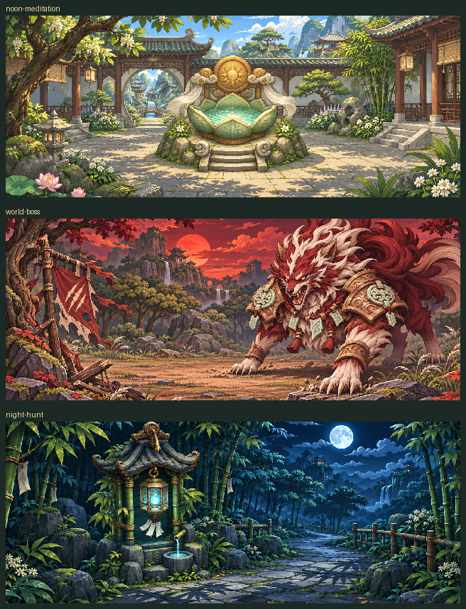
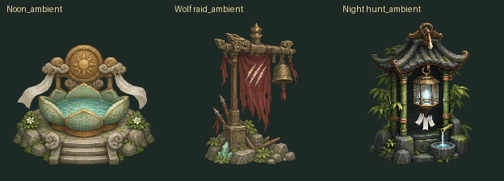
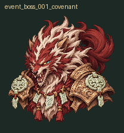
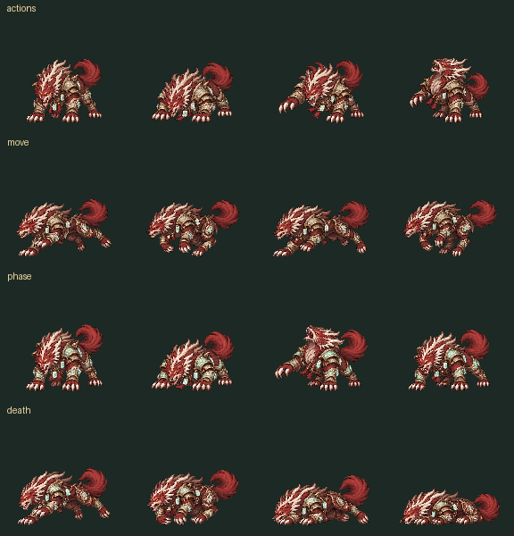

# Hướng mỹ thuật sự kiện theo nội dung 1.0.4

Kho tranh này được vẽ theo chủ đề sự kiện mà người dùng yêu cầu sau 1.0.4. Bản phát hành game tích hợp là **1.2.0** theo lựa chọn của người dùng: thẻ sự kiện xuất hiện trong bảng lịch, Lang Vương Thiên Khế dùng chuyển động chạy, lấy đà, tấn công, chuyển pha và chết. Mốc cảnh sự kiện còn là tranh dự phòng, vì hiện chưa có đối tượng tương tác tương ứng trên bản đồ.

## Thành phẩm

| Chủ thể | ID nguồn / lịch | Tranh đã xuất |
| --- | --- | --- |
| Ngọ Thời Tụ Linh | `noon-meditation` / `event_noon_basin` | Mốc cảnh 4 khung, avatar, icon, tranh thẻ ngang |
| Lang Vương Xâm Cảnh | `world-boss` / `event_wolf_standard` | Mốc cảnh 4 khung, avatar, icon, tranh thẻ ngang |
| Dạ Hành Trừ Yêu | `night-hunt` / `event_night_beacon` | Mốc cảnh 4 khung, avatar, icon, tranh thẻ ngang |
| Xích Nha Lang Vương · Thiên Khế | `boss_001` / `event_boss_001_covenant` | Avatar cận mặt và 4 dải × 4 khung: hành động, chạy, chuyển pha, chết |

Tổng cộng **17 ảnh thành phẩm**: 7 dải chuyển động (28 khung), 4 avatar, 3 icon và 3 tranh thẻ. `source/` chứa ảnh nguồn; `sheets/` chứa PNG dùng cho đợt lập trình sau; `previews/` chứa GIF và bảng xem nhanh; `manifest.json` ghi kích thước, ID, trạng thái và đường nguồn. Bản có nền trắng hoặc bầu trời bẩn được giữ ở `drafts/` và không xuất.

## Định hướng hình ảnh

- **Ngọ Thời:** ngọc xanh nước, đá sáng và đĩa mặt trời vàng cũ; cảm giác nghỉ ngơi, nước phản sáng trong lòng bồn. Không dùng luồng sáng vàng mờ chiếm cả màn hình. Sự kiện hiện cho nhận tu vi trực tiếp trong bảng sự kiện; mốc cảnh là đề xuất cho tương tác trên bản đồ sau này, chưa đại diện cho một đối tượng đã tồn tại trong map.
- **Lang Vương:** cờ móng sói báo cuộc xâm cảnh, nền rừng đỏ hoàng hôn. Biến thể Thiên Khế phải vẫn nhận ra là Xích Nha Lang Vương: lông nâu đỏ, bờm trắng, giáp đồng. Khác biệt đến từ các miếng ngọc khế ước gắn lên giáp và ánh sáng trong nét khắc, không chỉ đổi màu cả sprite. Đây là biến thể art của `boss_001`, không phải boss mới hoặc một HP thế giới chung.
- **Dạ Hành:** cọc đèn tuần tra, giấy trấn yêu và đường tre xanh đêm; vẫn đọc được lối đi và điểm tương tác. Tranh thẻ tránh đặt quái lạ vào nền để không tạo ra nhân vật thiếu avatar. Hiện phần thưởng săn quái gắn với Rừng Thanh Khê.
- Ba tranh thẻ **không có chữ** để UI tự đặt giờ, tên và trạng thái bằng văn bản sắc nét. Nhận diện sự kiện phải đọc được trước khi đọc chữ: vàng/ngọc ban ngày, đỏ đất hoàng hôn, lam tối và đèn cyan ban đêm.

## Quy ước tích hợp và sử dụng tiếp

- Mỗi mốc cảnh có `<ID>_ambient.png` gồm 4 frame `192 × 192`, `avatar_<ID>.png` `192 × 192`, `icon_<ID>.png` `64 × 64`. Mốc neo phần đế gần y = 184. Vùng va chạm chỉ bao chân đế, không chặn toàn bộ mái/cờ/tán.
- Lang Vương có 4 dải `128 × 128`, 4 frame mỗi dải. `actions`: đứng gồng → lấy đà → vồ → trúng đòn, là key pose theo trạng thái chứ không phát lặp như đi bộ. `move` lặp; `phase` và `death` phát một lần. Chân neo gần y = 120; dùng cùng tỉ lệ qua cả 16 khung.
- Avatar boss là tranh cận mặt và giáp vai, không lấy khung 128 phóng to. Cả ba mốc tương tác đều có avatar cùng ID theo `ART_DIRECTION.md`.
- `card_<event-id>.png` là ảnh RGBA 640 × 256 có nền cảnh chủ ý, không phải sprite trong suốt. Bảng lịch có thể phủ chữ HTML riêng lên card; cần kiểm tra tương phản ở 1366 × 768 khi tích hợp.
- Bản 1.2.0 nối tranh thẻ và boss theo trạng thái server; các mốc cảnh vẫn để dành cho bản đồ sự kiện sau. Cần kiểm tra nhịp hiển thị trong phiên chơi thật ở cả ba khung giờ trước khi công bố ngoài môi trường thử nghiệm.

## Cách kiểm tra và dựng lại

Chạy `python art/event-vision/export.py` rồi `python art/event-vision/validate.py`. Validator kiểm tra đủ ID sự kiện trong lịch máy chủ, 17 ảnh xuất, avatar của mọi chủ thể mới, alpha góc, kích thước, bốn khung khác nhau và dáng chết thấp hơn dáng đầu. Đối chiếu bằng `previews/gallery-*.png` và GIF từng dải. Prompt nguồn và hai lần sửa nền ở [PROMPTS.md](PROMPTS.md).
