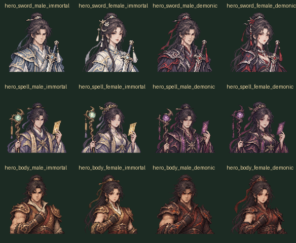
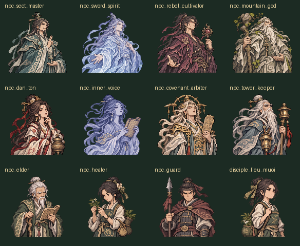
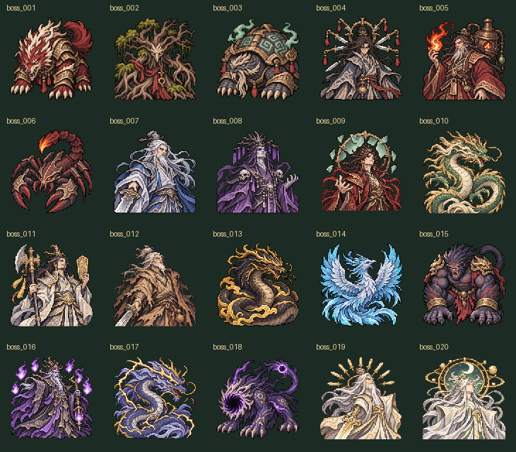
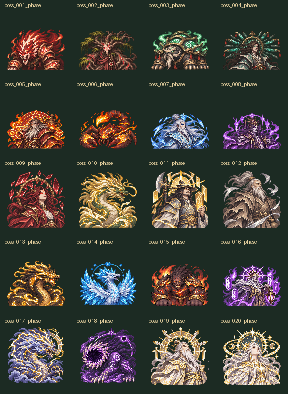
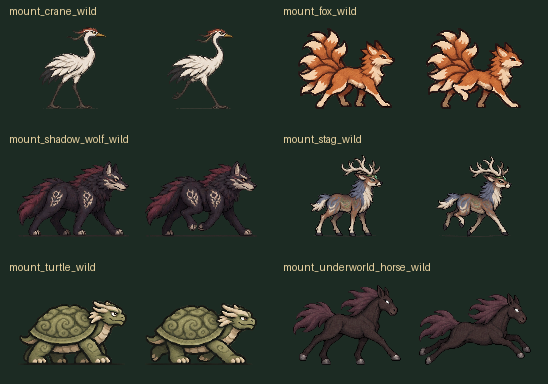
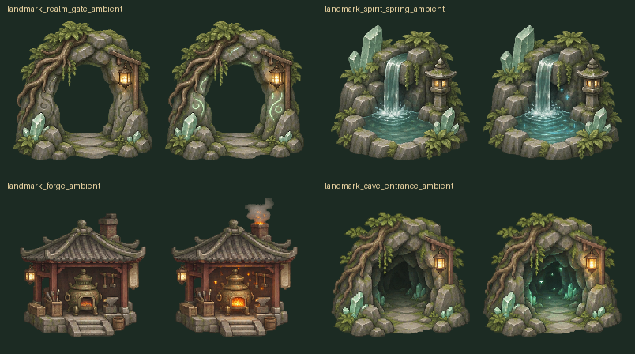
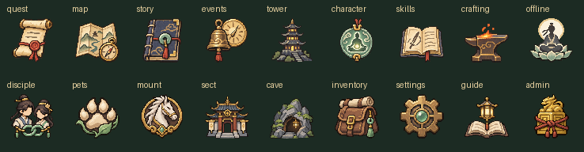

# Thư viện mỹ thuật chuẩn bị cho đợt phát triển sau

Bộ này là **tranh nguồn, ảnh đại diện, sheet và ảnh xem trước**. Chưa nối vào game, chưa thay các asset đang chạy, chưa đổi phiên bản.

## Đã chuẩn bị

| Nhóm | Thành phẩm | Cỡ ảnh | Mục đích |
| --- | ---: | ---: | --- |
| Avatar | 88 | 192 × 192 | 12 nhân vật người chơi, 13 NPC/đệ tử, 22 boss, 5 quái, 6 thú với hai trạng thái, 4 địa điểm tương tác; 20 boss lớn có thêm avatar chuyển pha |
| Thú hoang và thu phục | 12 dải / 48 khung | 4 × (128 × 96) | Sáu loài, tách khỏi hình cưỡi có yên cũ |
| NPC truyện di chuyển | 8 dải / 32 khung | 4 × (64 × 64) | Bước đi hoặc lơ lửng theo nhận diện riêng |
| Địa điểm tương tác | 4 dải / 16 khung | 4 × (192 × 192) | Cổng cổ, suối linh, lò rèn, cửa hang; mỗi nơi có avatar |
| Icon menu | 18 | 64 × 64 | Toàn bộ mục menu hiện có và GM, cùng nét đồng/ngọc/giấy |

Tất cả nguồn được vẽ dựa trên asset của dự án. Các atlas trong `source/` là ảnh gốc; `export.py` chỉ cắt ô, làm sạch alpha ngưỡng thấp, đặt vào khung cố định và thu bằng nearest-neighbor. `sheets/` là thành phẩm dùng để lập trình sau này. `manifest.json` ghép ID, tên file, nguồn, số khung và kích thước. `previews/` có GIF và bảng so sánh ở cỡ gần với game. Các bản ngựa U Minh và cổng/suối bị dính nền đã loại sang `drafts/`; bản `-v2` là bản được xuất.

Các điểm khó chịu đã xử lý trong bộ tranh này: avatar hội thoại trước đây lấy sprite toàn thân nhỏ nên mắt/mặt khó đọc; thú ở trạng thái chưa thu phục vẫn mang yên; NPC truyện thiếu dáng đi; biểu tượng menu không cùng một phong cách; cổng/suối trong bản phác đầu bị nền xám. Bản ngựa U Minh, cổng/suối và dáng Kiếm Hồn đã được vẽ lại khi kiểm tra nguồn. Thành phẩm vẫn cần xem trong game ở đợt tích hợp riêng để chốt nhịp chuyển động và độ tương phản trên từng nền bản đồ.

## Quy tắc áp dụng tiếp

Quy tắc avatar chính thức nằm ở [ART_DIRECTION.md](../../ART_DIRECTION.md). Mỗi nhân vật, boss, quái, thú hoặc điểm tương tác vẽ mới phải có avatar cùng ID. Một pha boss đổi nhận diện cần avatar pha đó. Avatar là tranh cận mặt/thân trên, không lấy sprite toàn thân 64 px kéo giãn. Hiệu ứng thuần túy đi theo avatar của chủ thể; icon giao diện được vẽ riêng.

- Avatar `192 × 192` RGBA, kiểm tra lại ở `96 × 96`; không ghép khung viền cứng vào ảnh để giao diện có thể tự chọn khung.
- NPC đi lại: chân ở khoảng `(32, 56)` trong khung `64 × 64`. Bốn khung là bốn key pose; nhân vật lơ lửng dùng neo đáy tương đương.
- Thú hoang và thu phục: khung `128 × 96`, cùng tỉ lệ qua tám khung, đáy ở y = 90. Hình hoang không có yên hoặc người cưỡi.
- Địa điểm tương tác: khung `192 × 192`, chân/đế ở y = 184. Cổng và hang để lối vào đọc được; collision khi tích hợp phải dựa trên footprint, không chặn cả hình chữ nhật tranh.
- Các sheet giữ alpha trong suốt; render bằng nearest-neighbor. GIF chỉ để xem nhịp; thời gian thực trong game sẽ do logic trạng thái quyết định.

Chạy `python art/future-library/export.py` để dựng lại thành phẩm và `python art/future-library/validate.py` để kiểm tra số lượng, alpha, khung trùng và avatar của toàn bộ roster hiện có. Rà cỡ ảnh bằng các bảng `previews/gallery-*.png`. Những vùng hoặc nhân vật chưa được thiết kế trong tài liệu game sẽ cần concept riêng khi được xác định; bộ này phủ roster hiện tại và các hướng mở rộng đã dự đoán.
