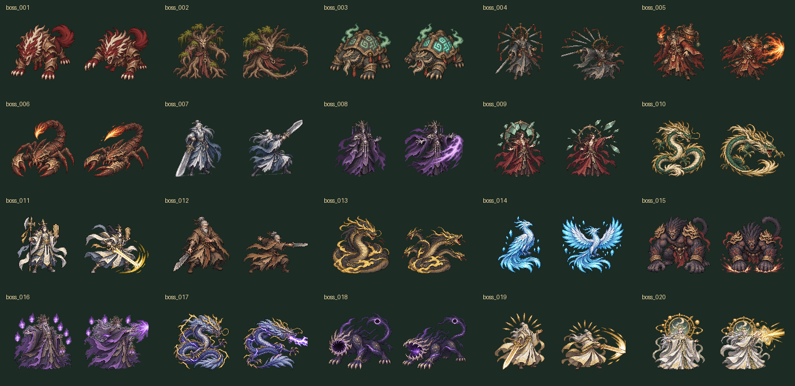
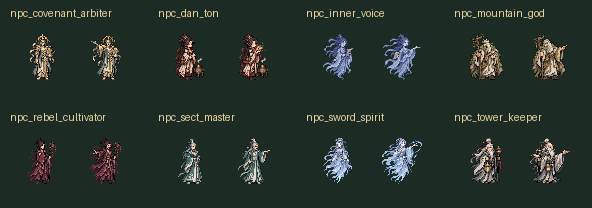
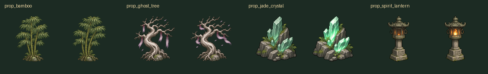
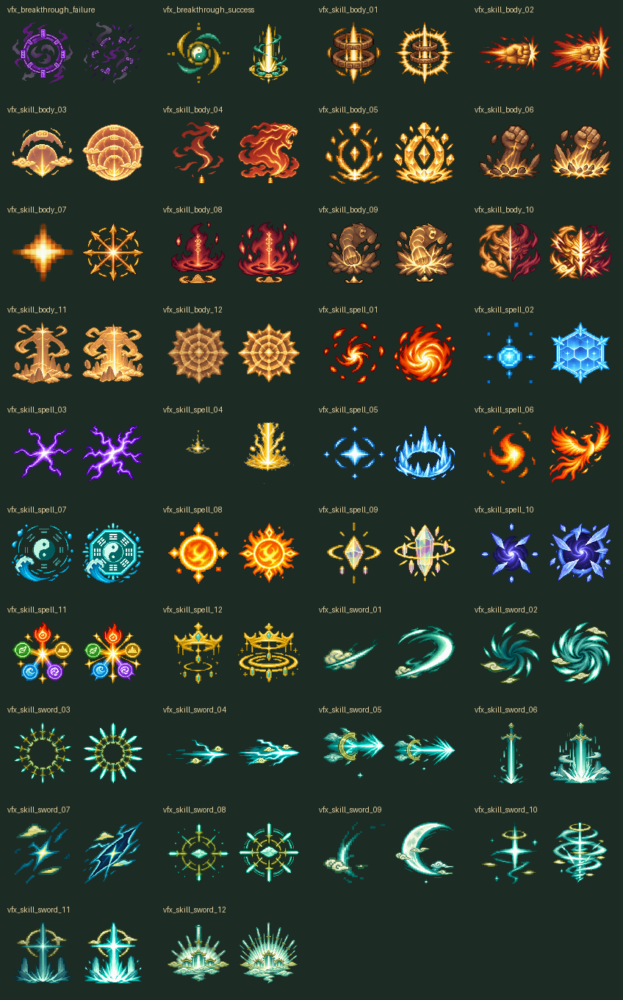

# Thư viện hoạt ảnh để duyệt mỹ thuật

Bộ này chỉ chứa tranh nguồn, sprite sheet và ảnh xem trước. Chưa nối vào mã game, chưa thay asset đang chạy và không đổi phiên bản.

## Đã vẽ

| Nhóm | Số sheet | Khung / sheet | Cỡ khung | Nội dung |
| --- | ---: | ---: | ---: | --- |
| Boss | 20 | 4 | 128 × 128 | Đứng, lấy đà, ra đòn, trúng đòn |
| NPC cốt truyện | 8 | 4 | 64 × 64 | Đứng, chào, nói, phản ứng |
| Cảnh vật | 4 | 4 | 128 × 128 | Tre, cây ma, tinh thạch, đèn linh hỏa |
| Hiệu ứng | 38 | 4 | 96 × 96 | Đủ 36 kỹ năng của ba hệ; đột phá thành công/thất bại |

Ảnh nguồn trong `source/` được vẽ dựa trên asset hiện có ở `client/public/assets/v110/`; hai hiệu ứng đột phá được vẽ mới. `sheets/` chứa ảnh RGBA bốn khung theo hàng ngang, thu bằng nearest-neighbor để giữ cạnh pixel rõ. `previews/` có GIF xem chuyển động và các bảng tổng hợp. Ảnh nguồn bị loại do nền bẩn lẫn alpha được giữ ở `drafts/`; bản `-v2` là bản dùng để đóng gói.

Xem từng hệ: [Kiếm](previews/gallery-vfx-sword.png) · [Pháp](previews/gallery-vfx-spell.png) · [Thể](previews/gallery-vfx-body.png) · [Đột phá](previews/gallery-vfx-breakthrough.png).

## Quy ước khi nối vào game sau này

- Boss: mỗi khung 128 × 128; chân/đế ở gần tâm ngang, y = 116. Bốn khung là các tư thế chính, chưa đủ để phát thành chuyển động 60 FPS. Có thể giữ từng tư thế vài nhịp và thêm thời gian chờ giữa các pha.
- NPC: mỗi khung 64 × 64; gót chân ở y = 56 theo `ART_DIRECTION.md`. Giữ cử chỉ nói chuyện tách khỏi lối đi, tránh trượt chân.
- Cảnh vật: bốn khung lặp; dùng tốc độ chậm cho tre/cây/tinh thạch và nhanh hơn cho lửa đèn.
- VFX: bốn khung một lần phát theo thứ tự hình thành → lớn dần → cực đại → tan. Điểm tác động ở tâm khung; không lặp trong lúc chiến đấu.
- Các sheet giữ alpha trong suốt, không có nền giả. Hiển thị bằng bộ lọc nearest để tránh mờ.

`python art/motion-library/pack_pose_strips.py` dựng lại sheet và GIF từ tranh nguồn. `python art/motion-library/make_galleries.py` dựng bảng tổng hợp. `python art/motion-library/validate_sheets.py` kiểm tra đủ sheet, kích thước, alpha và bốn khung khác nhau.

## Khoảng trống mỹ thuật cho đợt tiếp

- 36 hiệu ứng kỹ năng đã có bốn pha trong thư viện này; cần duyệt thời gian phát và vị trí va chạm trong game khi tích hợp.
- Boss cần thêm chuỗi di chuyển, chết và chuyển pha riêng khi cốt truyện dùng tới.
- Các cảnh cầu và đình là cấu trúc tĩnh nên không cần lắc toàn bộ; nên tách cờ, lá, ánh nước hoặc đèn thành lớp riêng nếu muốn thêm chuyển động.
- Nhân vật chính và thú cưỡi đã có sprite sheet ở `v104`/`v105`; cần duyệt ở kích thước game trước khi thay đổi để tránh vẽ lặp và lệch vị trí yên/cưỡi.

### Prompt mỹ thuật đã dùng

Các tranh nguồn được tạo từ ảnh tham chiếu của dự án bằng các chỉ dẫn chung: cùng nhận diện, bốn tư thế vẽ lại thật trong bốn ô ngang, toàn thân nằm trong từng ô, nền alpha trong suốt, pixel cluster sắc và màu tiên hiệp tiết chế; không làm mờ, nền sương, chữ, khung hay vật thể ngoài nhân vật. Các prompt riêng mô tả động tác phù hợp từng boss, NPC, đạo cụ hoặc kỹ năng. Những bản bị lẫn nền được vẽ lại với yêu cầu chỉ lấy cutout trong suốt.
