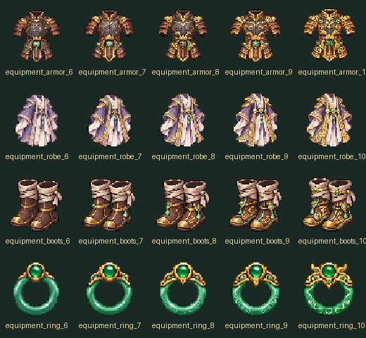
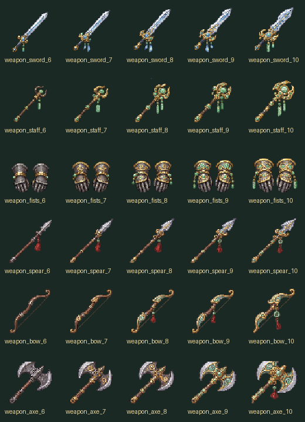
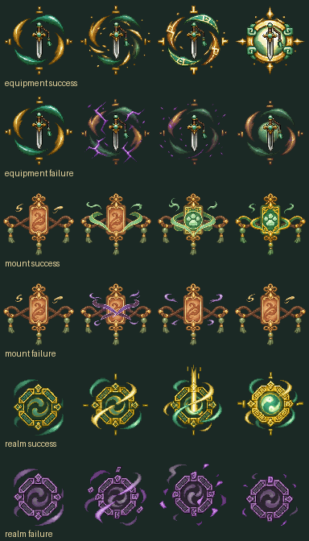

# Bộ tranh cường hóa 1.3.0

## Thành phẩm

Sáu atlas nguồn trong `source/` được vẽ theo hình dạng và bảng màu của game. `export.py` cắt ô, làm sạch alpha thấp, chuẩn hóa chân/neo và thu bằng nearest-neighbor. `sheets/` có **106 PNG**: 50 icon và 50 avatar vật phẩm cho cấp +6 đến +10, cùng sáu dải hiệu ứng bốn khung. `pack.py` chép các PNG đã duyệt vào `client/public/assets/v130/`; `manifest.json` ghi nguồn và kích thước.

| Nhóm | Cấp mới | Icon | Avatar |
| --- | --- | ---: | ---: |
| Giáp, đạo bào, giày, nhẫn | +6…+10 | 20 × 64² | 20 × 192² |
| Kiếm, trượng, quyền giáp, thương, cung, phủ | +6…+10 | 30 × 64² | 30 × 192² |
| Cường hóa đồ, thu phục thú, đột phá | thành công / thất bại | 6 dải × 4 khung 96² | Dùng avatar của chủ thể |

Mỗi cấp tăng chi tiết khảm thật trên vật thể, giữ nguyên dáng cơ bản để nhận diện ngay trong Túi. Hiệu ứng thất bại cho thấy dấu ấn tan đi nhưng vật phẩm và thú không bị phá hủy. Hai tư thế thành công/thất bại dùng màu vàng ngọc và tím trầm, mỗi dải giữ neo tâm. Không đưa chữ vào tranh. Bản vũ khí thứ nhất có mảnh thừa dưới cung được giữ trong `drafts/`; nguồn `-v2` đã được xuất, cắt phần thừa ở hàng cung và lọc các chấm rời nhỏ.

Chạy `python art/upgrade-v130/export.py`, `python art/upgrade-v130/validate.py`, `python art/upgrade-v130/pack.py` để dựng và kiểm tra lại. Validator yêu cầu đủ avatar theo quy tắc `ART_DIRECTION.md`, alpha góc trong suốt, kích thước chuẩn, năm cấp khác nhau và bốn khung hiệu ứng khác nhau. Không thay thế tranh +0 đến +5 của các bản trước.
